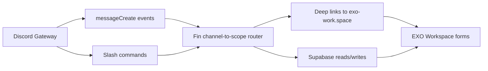

# Fin — EXO Workspace Discord Bot


Fin is the IEEE USF Exoskeleton Discord bot that bridges the server workflow with EXO Workspace (`https://exo-work.space`) and Supabase.
It routes file drops and slash commands into deterministic, sub-team-specific submission flows so students can submit work from Discord with deep links into the web workspace.

## System Architecture



### Why deterministic Gateway routing in v1?
- **Operational simplicity:** one long-lived bot process handles `messageCreate` + slash command routing without public interaction webhooks.
- **Predictable behavior:** fixed channel/scope mappings are easier for student maintainers to debug than probabilistic LLM routing.
- **Low overhead:** avoids extra HTTP signature-validation infrastructure needed for Discord Interactions-only architectures.

## Features & Commands

| Command / Trigger | Behavior | Required Permissions / Intents |
| --- | --- | --- |
| `/submit` | Opens or returns a scoped EXO Workspace submission link for the relevant team workflow. | `applications.commands`; bot online in target guild |
| `/workspace` | Returns canonical EXO Workspace entry links/resources for members. | `applications.commands` |
| `/ping` | Health/latency check confirming bot responsiveness. | `applications.commands` |
| Attachment posted in mapped submission channels (passive flow) | Bot detects file drop, resolves channel scope, and prompts with the correct deep-linked submission path. | `Guild Messages`, `Message Content Intent`, `Read Message History`, `Send Messages` |

## Repository Structure

> Current workspace snapshot contains only `/README.md`; expected bot source/config files (such as `src/`, `package.json`, and `.env.example`) are not present in this checkout.

Planned/expected runtime layout for this bot repository:

```text
src/
  events/        # Gateway event handlers (e.g., messageCreate)
  commands/      # Slash command implementations (/submit, /workspace, /ping)
  router/        # Channel-to-scope mapping and deep-link resolver
  services/      # Supabase + EXO Workspace integration helpers
  index.js       # Bot bootstrap entrypoint
deploy-commands.js
.env.example
```

## Local Setup & Deployment

### Prerequisites
- Node.js **20+** (LTS recommended)
- npm
- A Discord application + bot token from the Discord Developer Portal
- **Message Content Intent enabled** in the bot settings

### Setup Steps
1. Install dependencies:
   ```bash
   npm install
   ```
2. Create local env file:
   ```bash
   cp .env.example .env
   ```
3. Fill `.env` values (see table below).
4. Deploy slash commands:
   ```bash
   node deploy-commands.js
   ```
5. Start the bot:
   ```bash
   npm start
   ```

### Environment Variables

| Variable | Description | Required |
| --- | --- | --- |
| `DISCORD_TOKEN` | Discord bot token from Developer Portal. | Yes |
| `DISCORD_CLIENT_ID` | Discord application client ID used for command registration. | Yes |
| `DISCORD_GUILD_ID` | Development/testing guild ID for scoped command deploys. | Usually (dev), Optional (global deploy pattern) |
| `SUPABASE_URL` | Supabase project URL. | Yes |
| `SUPABASE_ANON_KEY` | Supabase anon/service access key used by bot integration layer. | Yes |
| `EXO_WORKSPACE_BASE_URL` | Base URL for deep links (default `https://exo-work.space`). | Optional |
| `PORT` | HTTP healthcheck port for host platform. | Optional |

### Hosting Note (`/health`)
For free-tier worker/container hosts (e.g., Render, Linux VM managed with `pm2`), expose a lightweight `GET /health` endpoint so uptime probes can confirm the process is alive.

## Governance & Attribution

This bot operates under the [EXO Workspace Privacy Policy](https://exo-work.space/privacy.html) and [Terms of Service](https://exo-work.space/terms.html).

**Maintainer:** Jordan Martin ([@cristobairl](https://github.com/cristobairl)) — IEEE USF Exoskeleton Software/Workspace Lead.
